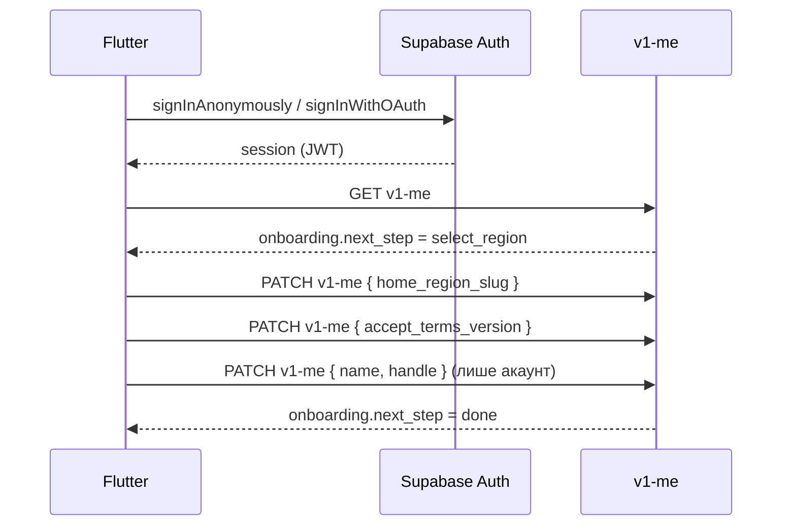

# Auth Flow — Грибний Радар

Як Flutter-клієнт входить, проходить онбординг і працює з Home Region.
Звірено з кодом 2026-11-25 (DOC-001). Джерело істини — код:

- клієнт: `flutter_client/lib/data/repositories/auth_repository.dart`, `flutter_client/lib/data/api/api_client.dart`;
- сервер: `supabase/functions/_shared/v1/me.ts` (профіль, онбординг, область), `supabase/functions/_shared/http.ts`
  (JWT і гість), `supabase/functions/auth-matrix.json` + `supabase/config.toml` (хто й що може викликати);
- рішення: ADR-001 (гість), ADR-002 (фото), ADR-016 (зміна області), ADR-022 (Наглядач) у [DECISIONS.md](./DECISIONS.md).

---

## 1. Вхід

Автентифікація — Supabase Auth через `supabase_flutter`.

| Спосіб | Виклик у клієнті | Примітка |
|---|---|---|
| Гість («Продовжити без реєстрації») | `signInAnonymously()` | ADR-001: справжній UUID і JWT, `is_anonymous = true` |
| Google | `signInWithOAuth(OAuthProvider.google)` | у зовнішньому браузері, повернення через deep link |
| Гість → акаунт | `linkIdentity(OAuthProvider.google)` | UUID не змінюється — точки, ділянки й налаштування гостя лишаються |
| Вихід | `signOut()` | |

Apple-вхід передбачено в текстах сервера («після входу через Google або Apple»), але в клієнті його ще немає
(iOS-ціль — IOS-001).

### Токен

```
Authorization: Bearer <access_token>
```

Токен бере з поточної сесії `ApiClient`; `supabase_flutter` сам оновлює його через refresh token. Окремо
зберігати access token не потрібно.

### Які ендпоінти потребують JWT

Класифікація — `supabase/functions/auth-matrix.json` (SEC-004); для класу `user_jwt` платформа перевіряє JWT ще до
коду функції. Гостьовий JWT — теж JWT: гість проходить перевірку, а обмеження для нього (§3) накладає код.

| Клас | Функції | Без токена |
|---|---|---|
| `public` | `regions`, `v1-regions` (геометрія області), `catalog`, `v1-app-config`, `v1-air-alerts` | працюють (з rate limit) |
| `user_jwt` | `v1-me`, `v1-picks`, `v1-analysis`, `v1-forecast`, `v1-forest-zones`, `v1-friends`, `v1-guardian`, `me` | `401` |
| `mixed_handler_auth` | `picks` (стара стрічка) | частина — публічна, частина — `401` |
| `service_role` | `v1-guardian-tick`, `v1-wave-alerts` | лише розклад / сервер |
| `webhook_secret` | `v1-telegram-webhook` | лише Telegram із секретом |

Клієнт використовує `v1-*`, а також `GET /regions` (список областей). Старі `me` і `picks` клієнт не викликає.

---

## 2. Онбординг

Порядок кроків вирішує сервер: `GET v1-me` повертає `onboarding.next_step` і готовий текст `next_step_label`
(Thin Client). Клієнт лише показує відповідний екран.

| `next_step` | Екран | Запит |
|---|---|---|
| `select_region` | вибір області | `GET /regions`, далі `PATCH v1-me { home_region_slug }` |
| `accept_terms` | умови й політика | `PATCH v1-me { accept_terms_version }` (поточна версія — `onboarding.terms_version`) |
| `profile` | ім'я та нік (лише акаунт; гість цей крок пропускає) | `GET v1-me?check_handle=<нік>`, `PATCH v1-me { name, handle }` |
| `done` | головний екран | — |



Рядок у `public.users` створює тригер `handle_new_user()` під час першого входу.

---

## 3. Гість (ADR-001)

Гість користується прогнозом, ділянками, картою, довідником, розпізнаванням і приватними точками. Сервер
відмовляє `403 registration_required` (з текстом «після входу через Google або Apple») для:

- імені, ніку й аватара (`PATCH v1-me`);
- трофеїв (`GET v1-me?trophies=1`);
- друзів (`v1-friends`) і Наглядача (`v1-guardian`, SOS).

`GET v1-me` для гостя повертає `is_guest: true`, `name`/`handle` = `null`; публічні точки визначає
`picks.public_allowed` / `public_hint_label` (рівень і ліміти — на сервері, ADR-019).

---

## 4. Home Region

- Ідентифікатор в API — тільки **`slug`** (`^[a-z0-9][a-z0-9_-]{1,31}$`); `id` внутрішній.
  Помилки: `400 invalid_region_slug`, `404 region_not_found`.
- **Зміна області** (ADR-016, `decideRegionChange` у `me.ts`):
  1. одне безкоштовне виправлення протягом 24 год після першого вибору;
  2. у Pro — одна зміна за весь час (entitlements — B6.3; до запуску Pro недоступно);
  3. інакше — тільки через підтримку → `403 region_change_not_allowed`.
  Чи можна змінити зараз і чому — у `GET v1-me` → `region_change { allowed, reason_label }`. Кожна зміна пишеться в
  `region_change_log`.

---

## 5. Фото точки (ADR-002)

Тільки Signed Upload URL, без base64:

1. `POST v1-picks/upload-url { client_id, content_type, size_bytes }` → `{ upload_url, path }`;
2. `PUT upload_url` — файл із диска;
3. `POST v1-picks { client_id, path, lat, lng, captured_at, visibility, … }` — сервер перевіряє файл і EXIF,
   вирізає EXIF.

---

## 6. Push-токени

- `PUT v1-friends/push { token, platform }` — запити в друзі, Наглядач (без координат у тексті);
- `PUT v1-analysis/push` — хвиля на ділянці.

---

## 7. Видалення акаунта

`DELETE v1-me` → `{ deleted: true }`: RPC `delete_user_account` видаляє `auth.users`, каскадом — профіль, точки,
ділянки, згоди (вимога Google Play).

---

## 8. Захист від зловживань

- Rate limit у `v1-*` (`enforceRateLimit`): якщо ліміт не вдається перевірити, змінні запити отримують `503`
  (fail closed, SEC-003); перевищення → `429`.
- Наглядач v0 (`guardian-*`, `X-Guardian-Token`, веб-сторінки за посиланням) прибрано 2026-11-22 (SEC-005); замінено
  на `v1-guardian` серед друзів (ADR-022).
