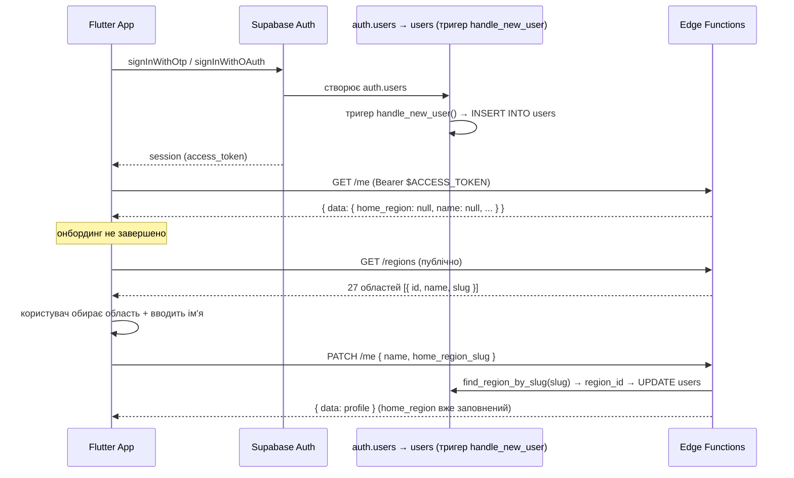

# Auth Flow — Грибний Радар

Як Flutter-клієнт авторизується, проходить онбординг і працює з Home Region.
Джерело істини — `supabase/functions/me/index.ts`,
`supabase/functions/_shared/forecast/me-endpoint.ts`,
`supabase/functions/_shared/guardian/auth.ts`.

---

## 1. Supabase Auth → JWT

Автентифікація — на боці Supabase Auth (Google / Email Magic Link / Apple —
налаштовується в Dashboard). Flutter використовує `supabase_flutter`:

```dart
final supabase = Supabase.instance.client;

// Email magic link
await supabase.auth.signInWithOtp(
  email: email,
  emailRedirectTo: 'io.supabase.mushroomradar://login-callback/',
);

// Google
await supabase.auth.signInWithOAuth(
  OAuthProvider.google,
  redirectTo: 'io.supabase.mushroomradar://login-callback/',
);
```

Після успіху сесія містить **access_token** (JWT):

```dart
final session = supabase.auth.currentSession;
final accessToken = session?.accessToken;   // плейсхолдер у докзах: $ACCESS_TOKEN
```

### Як передавати токен

```
Authorization: Bearer <access_token>
```

Токен короткоживучий — `supabase_flutter` автоматично оновлює його через
refresh_token. **Не зберігайте access_token вручну** — беріть із сесії.

### Що буде без токена

| Ендпоінт | Без токена |
|---|---|
| `POST /forecast` | ✅ працює (публічний) |
| `GET /regions` | ✅ працює (публічний) |
| `GET /catalog` | ✅ працює (публічний) |
| `GET /picks?scope=public` | ✅ працює |
| `GET /picks?scope=mine\|friends` | ❌ `401 unauthorized` |
| `POST /picks`, `GET /me`, `PATCH /me` | ❌ `401 unauthorized` |

Приклад: `401 unauthorized` означатиме «немає або битий заголовок
Authorization» — оновіть сесію (`supabase.auth.refreshSession()`).

---

## 2. Онбординг (перший вхід)



### Кроки

1. **Логін** — `supabase.auth.*`; рядок у `public.users` створюється
   автоматично тригером `handle_new_user()`.
2. **GET /me** — перевірка стану профілю (`home_region: null` → онбординг
   не завершено).
3. **GET /regions** — довідник для випадаючого списку (публічний, без токена).
4. **PATCH /me** — зберегти `name` + `home_region_slug` (оба або одне поле).
   Відповідь = свіжий профіль.
5. Далі — основний екран: `POST /forecast`, `GET /picks`, `POST /picks`.

---

## 3. Home Region

Home Region задає RegionGuard для прогнозу (`homeRegionId` → `POST /forecast`)
та скоуп `scope=region` у стрічці.

### Правило: тільки `slug`

```
regions.id — внутрішній, може змінитися при re-seed → НЕ хардкодити
regions.slug — стабільний публічний ідентифікатор → використовувати в API
```

- UI показує `regions.name` («Київська»).
- Клієнт відправляє **`home_region_slug`** у `PATCH /me`; сервер сам резолвить
  slug → id через RPC `find_region_by_slug`.
- `GET /regions` віддає пару (`id`, `slug`) — id потрібен лише для локального
  кешу, не для відправки.

### Валідація slug

Регулярка сервера: `^[a-z0-9][a-z0-9_-]{1,31}$` (2..32 символи, lowercase).
При помилці → `400 invalid_region_slug`; при неіснуючому slug → `404 region_not_found`.

### Зміна області

Наразі зміна можлива будь-коли через `PATCH /me` — **TODO/V2**: обмеження
1 зміна / 30 днів (anti-abuse). Підготовлена інфраструктура: таблиця
`region_change_log` (user_id, old/new_region_id, device_fingerprint,
changed_at) — див. [DB_SCHEMA.md](./DB_SCHEMA.md#region_change_log).

---

## 4. Дозволи пристрою (Flutter)

| Дозвіл | Навіщо | Коли запитувати |
|---|---|---|
| Геолокація (`whenInUse`) | `lat`/`lng` для `/forecast` і `/picks` | перед першим прогнозом |
| Push-нотифікації (FCM) | сповіщення про стан походу; токен → `POST /guardian-register-device` | після онбордингу |
| Камера / фото | фото знахідки (`photoBase64` ≤ 5 MiB, JPEG/PNG/WebP) | при створенні pick |
| Контакти | (лист Наглядача) — заплановано, **TODO/V2** | не запитувати зараз |

Фото клієнт **ре-компресить** перед відправкою: ліміт Edge Function —
5 MiB після декодування base64. EXIF-верифікація та rate-limit для
`/picks` — **TODO/V2** (див. коментарі в `supabase/functions/picks/index.ts`).

---

## 5. Повний приклад: перший запит прогнозу

```dart
// 1. Сесія (після логіну)
final token = Supabase.instance.client.auth.currentSession!.accessToken;

// 2. Перевірка онбордингу
final me = await http.get(
  Uri.parse('$supabaseUrl/functions/v1/me'),
  headers: {'Authorization': 'Bearer $token'},
);
// home_region == null → показати екран онбордингу

// 3. Прогноз (публічний — токен не обов'язковий)
final forecast = await http.post(
  Uri.parse('$supabaseUrl/functions/v1/forecast'),
  headers: {'Content-Type': 'application/json'},
  body: jsonEncode({
    'lat': position.latitude,
    'lng': position.longitude,
    'date': DateTime.now().toIso8601String(),
    'forestType': null,            // null = тип лісу невідомий
    'forestConfirmed': false,
    'homeRegionId': 1,             // id з профілю (не хардкод!)
  }),
);
// 200 → ForecastResult (сирий JSON, без { data })
// 403 outside_home_region → користувач поза домашньою области
```

---

## 6. Guardian-контур (окремо)

Наглядач авторизується **не** Supabase-JWT, а власним токеном:
`X-Guardian-Token` (видається під час створення сесії). Endpoints
`guardian-*` цього токена не приймають. Flutter-клієнту достатньо
`POST /guardian-register-device` (FCM-токен грибника, JWT).

---

## TODO / V2

- Rate limiting на Edge Functions (план §15) — поки захист лише на рівні платформи.
- Anti-abuse Home Region (1 зміна / 30 днів) — інфраструктура `region_change_log` готова, логіка обмеження — ні.
- EXIF-верифікація фото в `POST /picks`.
- Контакт Наглядача (SMS) — Web Push частково покрито через `guardian_notify` + `guardian-webhook-sms`.
