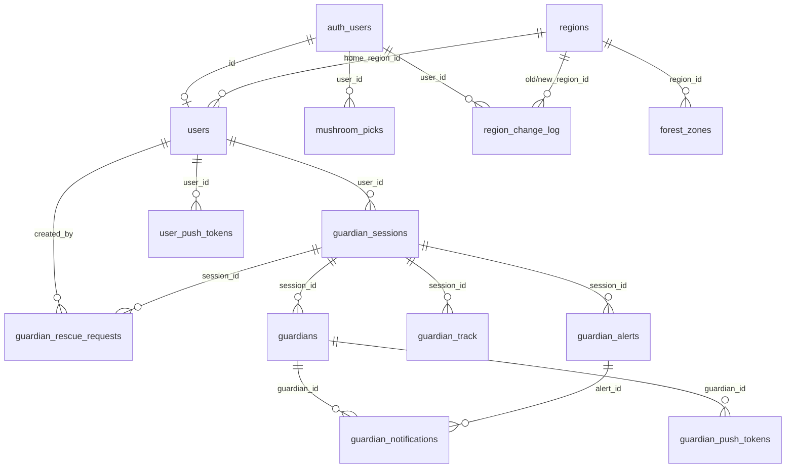

# DB Schema — Грибний Радар

Схема бази даних Supabase (PostgreSQL + PostGIS). Всі таблиці — у схемі `public`,
геометрія — `extensions.GEOMETRY(MultiPolygon, 4326)` / `GEOGRAPHY`.

Джерело істини — міграції `supabase/migrations/` (65 файлів на 2026-11-25). API-контракти —
[openapi/v1.yaml](../openapi/v1.yaml) і [API.md](./API.md).

> **Звірено з міграціями 2026-11-25 (DOC-001).** Огляд нижче — повний і актуальний. Детальні розділи про
> колонки старих таблиць писалися поетапно (2026-09…11); 21 таблицю, додану пізніше, описано в кінці файла
> ([«Таблиці 2026-11»](#таблиці-2026-11-згенеровано-з-міграцій)) — розділ згенеровано з БД. Якщо опис розходиться
> з міграцією, правда — у міграції.

---

## Огляд таблиць (44)

| Категорія | Таблиці |
|---|---|
| Користувачі | `users`, `region_change_log`, `user_consents`, `user_trophies`, `rating_events` (журнал балів, ADR-012) |
| Довідники | `regions`, `mushroom_catalog`, `expert_rules`, `feature_flags` |
| Геодані | `forest_zones`, `forest_polygons` |
| Тук-туки | `mushroom_picks`, `calibration_log` |
| «Знайшли?» (ADR-014, B3.11) | `forecast_views` (прогнози, які людина отримала: пише `save_analysis_result`), `trip_feedback` (відгуки після походу; місце не зберігається); `users.feedback_trust` |
| Аналіз ділянки | `analysis_areas`, `analysis_usage`, `analysis_forest_edits`, `analysis_history`, `gdd_state`, `weather_cache` |
| Сповіщення | `push_devices`, `wave_alerts`, `air_alerts_cache` |
| Друзі | `friendships`, `friend_request_log`, `user_reports` |
| Наглядач (ADR-022, `v1-guardian`) | `guardian_links`, `hikes`, `hike_guardians`, `hike_points`, `guardian_telegram`, `telegram_link_codes` |
| Ліміти запитів | `ip_rate_limit`, `notification_rate_limit` |
| Наглядач v0 — **застарілі** | `guardian_sessions`, `guardians`, `guardian_track`, `guardian_alerts`, `guardian_notifications`, `guardian_rescue_requests`, `guardian_push_tokens`, `user_push_tokens`, `guardian_tick_log` |

Наглядача v0 (функції `guardian-*`, cron-завдання й тригер сповіщень) прибрано 2026-11-22 (SEC-005, міграція
`20261122110000_retire_guardian_v0_jobs.sql`). Таблиці з даними лишилися: видалення чи строк зберігання — рішення
власника (docs/agent/BLOCKERS.md, BLK-009). Розділ «Наглядача (Guardian)» нижче описує саме їх.

---

## Користувачі

### `users`

Рядок створюється тригером `handle_new_user()` на `auth.users` (migration
`20260910000001`).

| Колонка | Тип | Опис |
|---|---|---|
| `id` | UUID PK → `auth.users(id)` `ON DELETE CASCADE` | = auth user id |
| `name` | TEXT | відображуване ім'я |
| `email` | TEXT | копія з Auth |
| `avatar_url` | TEXT | |
| `rating` | INT NOT NULL DEFAULT 0 | репутація |
| `total_verified_picks` | INT NOT NULL DEFAULT 0 | верифіковані знахідки |
| `home_region_id` | INT → `regions(id)` `ON DELETE SET NULL` | домашня область |
| `created_at` / `updated_at` | TIMESTAMPTZ | |

**RLS:** `users_self_read` (SELECT `auth.uid() = id`), `users_self_update`
(UPDATE `USING (auth.uid() = id)` + `WITH CHECK (auth.uid() = id)`,
hardening 20260912000017).

### `region_change_log`

Аудит зміни домашньої області (підготовка anti-abuse V2).

| Колонка | Тип |
|---|---|
| `id` | UUID PK |
| `user_id` | UUID → `auth.users(id)` CASCADE |
| `old_region_id` / `new_region_id` | INT → `regions(id)` |
| `device_fingerprint` | TEXT |
| `changed_at` | TIMESTAMPTZ |

---

## Довідники

### `regions`

27 областей України (seed `20260912000014`).

| Колонка | Тип | Опис |
|---|---|---|
| `id` | SERIAL PK | **не хардкодити в клієнті** — використовуй `slug` |
| `name` | TEXT NOT NULL | «Київська» |
| `slug` | TEXT | `kyivska` — стабільний ідентифікатор для API |
| `koatuu` / `katottg` | TEXT UNIQUE | коди КОАТУУ / КАТОТТГ |
| `polygon` | `extensions.GEOMETRY(MultiPolygon, 4326)` NOT NULL | кордон області |
| `created_at` / `updated_at` | TIMESTAMPTZ | |

**RLS:** `regions_read` — тільки `authenticated` (SELECT); публічний доступ
через `GET /regions` (service_role у Edge Function обходить RLS).

### `mushroom_catalog`

326 видів (seed з `mushroom_catalog.json`, migration `20260912000004`).

| Колонка | Тип | Опис |
|---|---|---|
| `id` | TEXT PK | канонічний snake_case id (`boletus_edulis`) |
| `name_ua` / `name_lat` | TEXT NOT NULL | назви |
| `edibility` | TEXT CHECK (`edible`/`conditionally_edible`/`inedible`/`poisonous`/`deadly_poisonous`) | їстівність |
| `edibility_label` | TEXT | «Їстівний» |
| `red_listed` | BOOLEAN NOT NULL DEFAULT FALSE | Червона книга |
| `rarity` | TEXT | рідкісність |
| `has_photo` / `popular` / `ai_recognition` | BOOLEAN NOT NULL DEFAULT FALSE | |
| `top20` | BOOLEAN NOT NULL DEFAULT FALSE | ТОП-20 (сид виставляє TRUE) |
| `features` | TEXT | |
| `months` | INT[] NOT NULL DEFAULT '{}' | місяці плодоношення |
| `attrs` | JSONB NOT NULL DEFAULT '{}' | `{tree: [], season: [], color: [], stem: []}` |
| `photos` | JSONB NOT NULL DEFAULT '[]' | `[{url}]` |
| `peak_months` | INT[] NOT NULL DEFAULT '{}' | пікові місяці |
| `zones` | TEXT[] NOT NULL DEFAULT '{}' | області поширення (slug'и) |
| `license` / `red_book_source` | JSONB | |
| `updated_at` | TIMESTAMPTZ | |

**RLS:** `catalog_read` — тільки `authenticated`.

### `expert_rules`

Правила скорингу ForecastEngine (seed 20 видів ТОП-20, migration
`20260912000002`; констрейнти — `20260912000009`). Повний набір колонок
(46) відповідає `SpeciesRule` у `supabase/functions/_shared/forecast/types.ts`.
Ключові групи:

- температури: `fruiting_temp_min/max`, `fruiting_temp_peak_min/max`, `mycelium_temp_min/max` (NUMERIC)
- вологість/опади: `humidity_min`, `rain_1d_min`, `rain_2d_min`, `rain_3d_min`, `drought_days_min`, `days_after_rain_min/max`, `waterlogged_penalty`, `drought_then_rain`
- середовище: `forest_type[]`, `habitat_type[]`, `relief_type[]`, `altitude_min/max`, `soil_ph_min/max`, `light_preference`, `stand_age_min/max`
- сезон: `season_start`, `season_end` (формат `MM-DD`), `wave_spring/summer1/summer2/autumn/late`, `peak_waves[]`, `peak_months[]`
- рефугіуми: `microrefugium_dry`, `microrefugium_wet`, `indicator_species[]`, `shock_required`
- мета: `legacy_id` UNIQUE, `mushroom_type` UNIQUE, `region_ids[]`, `weight`, `mvp_stage` (`mvp` за замовчуванням), `last_calibrated_at`

**RLS:** `expert_rules_read` — тільки `authenticated`; запис — лише service_role.
Повний актуальний набір правил для regression-тестів —
`supabase/tests/fixtures/rules-subset.json`.

### `feature_flags`

Флаги ForecastEngine (`loadFeatureFlags`).

| Колонка | Тип |
|---|---|
| `key` | TEXT PK |
| `enabled` | BOOLEAN NOT NULL DEFAULT TRUE |
| `value` | JSONB NOT NULL DEFAULT 'null' |
| `updated_at` | TIMESTAMPTZ |

Рівні: `fruiting_temp_buffer`, `region_filter_enabled`,
`auto_calibration_enabled`, `rule5_anti_double_counting_enabled`,
`indicator_pidvyshen_enabled`, `pressure_enabled`, `light_enabled`,
`relief_enabled`, `gdd_enabled`, `peak_wave_bonus_enabled`.

---

## Геодані

### `forest_zones`

Полігони лісових зон (окремий шар; `find_zone_by_point`).

| Колонка | Тип | Опис |
|---|---|---|
| `id` | UUID PK | |
| `polygon` | `extensions.GEOMETRY(MultiPolygon, 4326)` NOT NULL | межа зони |
| `forest_type` | TEXT | |
| `stand_age_years` | INT CHECK 0..500 | вік деревостану |
| `stand_age_source` | TEXT CHECK (`inventory`/`ndvi`/`user`) | |
| `stand_age_confidence` | NUMERIC(3,2) CHECK 0..1 | |
| `relief_type` | TEXT | |
| `light_type` | TEXT | |
| `region_id` | INT → `regions(id)` | область |
| `created_at` | TIMESTAMPTZ | |

**RLS:** `forest_zones_read` — тільки `authenticated`. Клієнтський доступ —
через RPC `find_zone_by_point` (stand_age/relief/light для прогнозу).

### `forest_polygons`

OSM-геозони лісів (migration `20260911000003`).

| Колонка | Тип |
|---|---|
| `id` | BIGSERIAL PK |
| `polygon` | `GEOGRAPHY(MultiPolygon, 4326)` NOT NULL |
| `source` | TEXT NOT NULL DEFAULT 'osm' |
| `osm_id` | BIGINT |
| `region_id` | INT (без FK — для гнучкості імпорту) |
| `created_at` | TIMESTAMPTZ |

**RLS + доступ:** RLS увімкнено, політик немає (deny-all) **і** жодних GRANT
для `anon`/`authenticated` — таблиця лише для service_role
(hardening 20260912000017). Перевірка точки — RPC `is_point_in_forest`
(SECURITY INVOKER, викликається з Edge Function із service_role).

---

## Тук-туки

### `mushroom_picks`

| Колонка | Тип | Опис |
|---|---|---|
| `id` | UUID PK | |
| `user_id` | UUID NOT NULL → `auth.users(id)` CASCADE | автор |
| `trip_id` | UUID NULL | походи (зарезервовано) |
| `client_id` | UUID NULL, UNIQUE (`user_id`, `client_id`) | ключ ідемпотентності офлайн-черги (ADR-002) |
| `geom` | `GEOGRAPHY(Point, 4326)` NOT NULL | **точні** координати — тільки автору і серверу |
| `display_geom` | `GEOGRAPHY(Point, 4326)` NULL | зсунуте місце публічної точки (300–500 м, ADR-018 §18.5); CHECK: у `public` завжди заповнене |
| `photo_url` | TEXT NULL | шлях у bucket `mushroom-photos` (не публічний URL): `picks/<id>.<ext>` для v1-picks, `<user_id>/<id>.<ext>` для старого `POST /picks` |
| `mushroom_type` | TEXT NOT NULL | id каталогу; `unknown` для «Не знаю» (сумісність зі старим кодом прогнозу) |
| `species_id` | TEXT NULL → `mushroom_catalog(id)` | вид із довідника; NULL = «Не знаю». CHECK: `public` ⇒ NOT NULL |
| `description` | TEXT NULL, CHECK ≤ 500 символів | опис без контактів |
| `ai_check` | JSONB NULL | підказка ШІ з телефону + `exif` (серверна перевірка EXIF) |
| `twin_alert` | BOOLEAN NOT NULL DEFAULT false | ШІ побачив отруйного двійника — без автопідтвердження |
| `captured_at` | TIMESTAMPTZ NULL | час зйомки на пристрої |
| `deleted_at` | TIMESTAMPTZ NULL | м'яке видалення |
| `forest_type` | TEXT NULL | |
| `weather_data` | JSONB NULL | умови (наприклад `{gpsAccuracy}`) |
| `pick_type` | TEXT NOT NULL CHECK (`private`/`public`) | видимість (`friends` скасовано ADR-018) |
| `shared_with` | UUID[] NOT NULL DEFAULT '{}' | застаріло (ADR-018), завжди порожня |
| `verification_status` | TEXT NOT NULL DEFAULT 'pending' | `pending`/`verified`/`conditional`/`rejected`; нові точки v1-picks — завжди `pending` |
| `verified_by` | UUID NULL → `auth.users(id)` | |
| `weight` | NUMERIC(3,2) NOT NULL DEFAULT 1.0 | вага для краудсорсингу |
| `is_indicator` | BOOLEAN NOT NULL DEFAULT FALSE | індикаторний вид |
| `is_negative` | BOOLEAN NOT NULL DEFAULT FALSE | негативний звіт |
| `created_at` | TIMESTAMPTZ | |

**RLS:** `mushroom_picks_read` — **тільки власні точки**. Чужі публічні точки віддає лише
Edge Function (service_role) і лише `display_geom`. Запис (INSERT / UPDATE / DELETE) для
клієнтських ролей відкликано: точки створює `create_pick()` з Edge Function `v1-picks`.

**Функції (тільки service_role):** `can_create_pick(user_id, visibility)` → `(allowed, code,
message)` — добові ліміти та рівень «Лісовик» для публічних; `create_pick(...)` — атомарна
вставка: перевірка `client_id` і ліміту під блокуванням користувача.

### `calibration_log`

Аудит автокалібровки правил: `date`, `species`, `param`, `old_value`,
`new_value`, `reason`, `approved_by` → `auth.users(id)`, `created_at`.

---

## Наглядача (Guardian) — v0, застарілі (див. огляд)

Контур сесій грибника з Наглядачем. Auth — не JWT, а токен Наглядача
(`X-Guardian-Token`).

### `guardian_sessions`

20 колонок: `id` UUID PK, `user_id` → `users(id)` CASCADE, `status`
(`pending`/`active`/`closing`/`closed`/`recoverable`), `previous_status`
(той самий enum; додано `20260911000002`, для cancel-close), `expected_return`,
`original_return`, `started_at`, `closing_started_at`, `closed_at`,
`recoverable_until`, `last_known_coords` GEOGRAPHY, `last_known_at`,
`last_battery_pct` (0..100), `last_signal_strength` (0..5),
`exit_detected_at`, `sos_activated_at`, `overdue_level`
(`soft`/`medium`/`hard`), `settings` JSONB, `created_at`, `updated_at`.

**RLS:** `guardian_sessions_self_*` (read/insert/update) — `user_id = auth.uid()`.

### `guardians`

`id` UUID PK, `session_id` → `guardian_sessions(id)` CASCADE, `name`,
`phone`, `token_hash` UNIQUE, `token_prefix`, `is_emergency`,
`notified_at`, `last_seen_at`, `revoked_at`, `created_at`.
**RLS:** `guardians_owner_*` — через існування сесії користувача.

### `guardian_track`

`id` BIGSERIAL PK, `session_id` → `guardian_sessions(id)` CASCADE,
`coords` GEOGRAPHY NOT NULL, `recorded_at`, `battery_pct`, `signal_strength`,
`speed_kmh`, `was_offline`, `created_at`.
**RLS:** `guardian_track_owner_*`.

### `guardian_alerts`

`id` BIGSERIAL PK, `session_id` → `guardian_sessions(id)` CASCADE,
`alert_type` (`sos`/`overdue_soft`/`overdue_medium`/`overdue_hard`/`offline`),
`payload` JSONB, `delivered_at`, `created_at`. На INSERT — тригер
`notify_guardian_alert()` → HTTP POST на Edge Function `guardian-notify`.

### `guardian_notifications`

`id` BIGSERIAL PK, `guardian_id` → `guardians(id)` CASCADE,
`alert_id` → `guardian_alerts(id)` SET NULL, `channel`
(`push`/`sms`), `status`, `provider_message_id`, `error_message`,
`sent_at`, `delivered_at`, `created_at`.

### `guardian_rescue_requests`

`id` UUID PK, `session_id` → `guardian_sessions(id)` CASCADE,
`created_by` → `users(id)`, `token_hash` UNIQUE, `token_prefix`,
`target` (def `101`), `notes`, `payload` JSONB, `expires_at`,
`resolved_at`, `resolved_note`, `viewed_count`, `last_viewed_at`,
`created_at`. Політики `guardian_rescue_owner_*` (created_by +
перевірка сесії; `WITH CHECK` додано 20260912000017).

### `guardian_push_tokens`

`id` BIGSERIAL PK, `guardian_id` → `guardians(id)` CASCADE, `fcm_token`,
`user_agent`, `created_at`, `last_seen_at`, `revoked_at`.

### `user_push_tokens`

`id` BIGSERIAL PK, `user_id` → `users(id)` CASCADE, `fcm_token`,
`platform` (`android`/`ios`/`web`), `device_info` JSONB, `created_at`,
`last_seen_at`, `revoked_at`.

### `guardian_tick_log`

`id` BIGSERIAL PK, `started_at`, `finished_at`, `sessions_scanned`,
`transitions_made`, `alerts_created`, `errors`, `error_details` JSONB.

> `guardian_push_tokens`, `user_push_tokens`, `guardian_tick_log` —
> service_role only: RLS без політик (deny-all) + REVOKE від anon/authenticated
> + FORCE ROW LEVEL SECURITY (hardening 20260912000017). Запис — лише через
> Edge Functions з service_role key.

---

## ER-діаграма (тільки реальні FK)

> Зовнішні ключі взяті з DDL міграцій. Таблиці без FK (`mushroom_catalog`,
> `expert_rules`, `feature_flags`, `forest_polygons`, `guardian_tick_log`,
> `calibration_log`) на діаграмі не відображені зв'язками — `calibration_log.approved_by`
> та `mushroom_picks.verified_by` теж References на `auth.users(id)`.

---

## RPC-функції

| Функція | Призначення | Хто викликає |
|---|---|---|
| `find_zone_by_point(lat, lng)` | forest_zone за точкою (stand_age, relief, light) | ForecastEngine (`ContextBuilder`) |
| `point_in_region(lat, lng, region_id)` | точка в межах області (RegionGuard) | ForecastEngine |
| `find_region_by_slug(slug_input)` | slug → `{id, name}` | `PATCH /me`, `GET /picks?scope=region` |
| `is_point_in_forest(lat, lng)` | точка в лісі (forest_polygons) | geofence (service_role) |
| `months_to_waves(...)` | календар хвиль | довідково |
| `guardian_fn_config()` | url + service_key з Vault для cron/тригерів | cron jobs, `notify_guardian_alert` (SECURITY DEFINER) |
| `notify_guardian_alert()` | тригер на `guardian_alerts` → HTTP на `guardian-notify` | AFTER INSERT тригер |
| `handle_new_user()` | тригер на `auth.users` → створення рядка `users` | AFTER INSERT тригер |
| `update_updated_at_column()` | `updated_at` тригери | BEFORE UPDATE тригери |
| `check_expert_rules_safe()` | валідація констрейнтів правил | міграція 20260912000009 |

GRANT EXECUTE на `find_zone_by_point`, `point_in_region`,
`find_region_by_slug` — `authenticated` (Edge Functions викликають через
service_role клієнт, який обходить RLS).

---

## Безпека (hardening, аудит B)

- 15/19 таблиць мають RLS-політики; 4 службові таблиці (`guardian_push_tokens`,
  `user_push_tokens`, `forest_polygons`, `guardian_tick_log`) — RLS без політик
  (deny-all) + `REVOKE ALL` від `anon`/`authenticated` + `FORCE ROW LEVEL SECURITY`.
- `service_role` має `BYPASSRLS` → Edge Functions працюють незалежно від FORCE RLS.
- 3 UPDATE-політики з явним `WITH CHECK`: `users_self_update`,
  `guardians_owner_update`, `guardian_rescue_owner_update`.
- `guardian_fn_config()` — `SECURITY DEFINER`, `search_path = public, vault`,
  EXECUTE лише для `postgres`/`service_role`.
- `notify_guardian_alert()` — `SECURITY DEFINER`, `SET search_path = public, vault`.

Деталі — міграція `20260912000017_security_hardening.sql`.

---

## Оновлення 2026-11-09 (робочий блок 1)

| Міграція | Що змінено |
|---|---|
| `20261109120000` | `forest_zones_geojson`: `security_invoker = on` (формалізація зміни з Dashboard) |
| `20261109120100` | RPC `get_region_geometry(slug, tolerance)` → спрощений кордон, bbox, центр (тільки service_role) |
| `20261109120200` | RPC `get_forest_zones_geojson_region(region_id, bbox?, max, tolerance)` — ліси лише однієї області; індекс `forest_zones(region_id)` |
| `20261109120300` | `is_registered()`; RESTRICTIVE-політики: гість вставляє/оновлює лише `private` точки і не створює `guardian_sessions` (ADR-001); `region_change_log.source` (`onboarding` / `onboarding_fix` / `pro` / `support` / `legacy`, ADR-016) |
| `20261109120400` | Таблиця `user_consents` (user_id, doc `eula`/`privacy`, version, accepted_at); RLS: читання — свої, запис — тільки service_role |
| `20261109120500` | **Виправлення приватності:** `mushroom_picks_read` більше не показує `private`/`friends` точки користувачам тієї ж області. Тепер: автор, `shared_with`, `public` |

## Оновлення 2026-11-11 (Тук-тук, B3.0 + B3.1)

| Міграція | Що змінено |
|---|---|
| `20261111000000` | **ADR-018.** `pick_type` — лише `private`/`public` (наявні `friends` → `private`, `shared_with` очищено). Нові колонки `mushroom_picks`: `client_id`, `species_id`, `description`, `ai_check`, `twin_alert`, `display_geom`, `captured_at`, `deleted_at`. CHECK: `public` ⇒ є `species_id` і `display_geom`; опис ≤ 500. **Приватність:** `mushroom_picks_read` — тільки власні точки; запис клієнтськими ролями відкликано. Функції `can_create_pick`, `create_pick` (service_role). Наявні публічні точки без виду з довідника стали приватними, решта отримали `display_geom` |

## Оновлення 2026-11-11 (карта тук-туків B3.3, аналіз ділянки B2.9)

| Міграція | Що змінено |
|---|---|
| `20261111100000` | Функції `get_picks_map(user, region, bbox…, include_private, limit)` і `get_pick_card(user, region, pick)` (тільки service_role). Для чужих точок повертають і використовують у фільтрах лише `display_geom`; точний `geom` — тільки автору |
| `20261111110000` | Таблиці `analysis_areas` і `analysis_usage`; функції `save_analysis_area`, `consume_analysis`, `refund_analysis`, `analysis_used_today`, `analyze_area_forest` (тільки service_role) |

### `analysis_areas`

Збережені ділянки машинного прогнозу (ADR-015). Безкоштовно — 1 ділянка (слот 1) 5×5 км.

| Колонка | Тип | Опис |
|---|---|---|
| `id` | UUID PK | |
| `user_id` | UUID NOT NULL → `auth.users(id)` CASCADE | власник |
| `slot` | SMALLINT CHECK 1..3, UNIQUE (`user_id`, `slot`) | слот ділянки (2–3 — Pro) |
| `center` | `GEOGRAPHY(Point, 4326)` NOT NULL | центр квадрата |
| `size_km` | SMALLINT CHECK IN (5, 10) | сторона квадрата (10 — Pro) |
| `region_id` | INT NOT NULL → `regions(id)` | область ділянки |
| `label` | TEXT NULL (≤ 60) | назва (зарезервовано) |
| `created_at`, `updated_at` | TIMESTAMPTZ | |

**RLS:** читання — тільки свої; запис — тільки service_role (`save_analysis_area`).

### `analysis_usage`

Лічильник аналізів: `user_id`, `area_id` → `analysis_areas(id)` CASCADE, `day` (київська дата),
`count`; PK (`user_id`, `area_id`, `day`). Клієнтським ролям недоступна. `consume_analysis`
збільшує лічильник одним оператором — паралельні запити ліміт не перевищать.

---

## Таблиці 2026-11 (згенеровано з міграцій)

Згенеровано 2026-11-26 зі свіжої БД (`scripts/dev/local-db/run.sh --no-tests`, 65 міграцій) скриптом
`scripts/dev/local-db/describe_tables.py`. Щоб оновити: підняти БД тим самим скриптом і перегенерувати розділ.
Що означають поля й правила доступу — у міграції таблиці та відповідному ADR.

### Користувачі й згоди

#### `user_consents`

| Колонка | Тип | Обов'язкова | За замовчуванням |
|---|---|---|---|
| `id` | uuid | так | `gen_random_uuid()` |
| `user_id` | uuid | так |  |
| `doc` | text | так |  |
| `version` | text | так |  |
| `accepted_at` | timestamp with time zone | так | `now()` |

Ключі: `FOREIGN KEY (user_id) REFERENCES auth.users(id) ON DELETE CASCADE`; `PRIMARY KEY (id)`; `UNIQUE (user_id, doc, version)`.
RLS: увімкнено; політики: SELECT authenticated.

#### `user_trophies`

| Колонка | Тип | Обов'язкова | За замовчуванням |
|---|---|---|---|
| `user_id` | uuid | так |  |
| `trophy_id` | text | так |  |
| `earned_at` | timestamp with time zone | так | `now()` |

Ключі: `FOREIGN KEY (user_id) REFERENCES auth.users(id) ON DELETE CASCADE`; `PRIMARY KEY (user_id, trophy_id)`.
RLS: увімкнено; політик немає — доступ лише service_role / SECURITY DEFINER-функцій.

#### `rating_events`

| Колонка | Тип | Обов'язкова | За замовчуванням |
|---|---|---|---|
| `id` | bigint | так |  |
| `user_id` | uuid | так |  |
| `delta` | integer | так |  |
| `reason` | text | так |  |
| `pick_id` | uuid |  |  |
| `created_at` | timestamp with time zone | так | `now()` |

Ключі: `FOREIGN KEY (pick_id) REFERENCES mushroom_picks(id) ON DELETE SET NULL`; `FOREIGN KEY (user_id) REFERENCES auth.users(id) ON DELETE CASCADE`; `PRIMARY KEY (id)`.
RLS: увімкнено; політики: SELECT authenticated.

### Аналіз ділянки

#### `analysis_forest_edits`

| Колонка | Тип | Обов'язкова | За замовчуванням |
|---|---|---|---|
| `area_id` | uuid | так |  |
| `user_id` | uuid | так |  |
| `day` | date | так |  |
| `count` | integer | так | `0` |

Ключі: `FOREIGN KEY (area_id) REFERENCES analysis_areas(id) ON DELETE CASCADE`; `FOREIGN KEY (user_id) REFERENCES auth.users(id) ON DELETE CASCADE`; `PRIMARY KEY (area_id, day)`.
RLS: увімкнено; політик немає — доступ лише service_role / SECURITY DEFINER-функцій.

#### `analysis_history`

| Колонка | Тип | Обов'язкова | За замовчуванням |
|---|---|---|---|
| `area_id` | uuid | так |  |
| `user_id` | uuid | так |  |
| `day` | date | так |  |
| `species` | text[] | так | `'{}'::text[]` |
| `updated_at` | timestamp with time zone | так | `now()` |

Ключі: `FOREIGN KEY (area_id) REFERENCES analysis_areas(id) ON DELETE CASCADE`; `FOREIGN KEY (user_id) REFERENCES auth.users(id) ON DELETE CASCADE`; `PRIMARY KEY (area_id, day)`.
RLS: увімкнено; політик немає — доступ лише service_role / SECURITY DEFINER-функцій.

#### `gdd_state`

| Колонка | Тип | Обов'язкова | За замовчуванням |
|---|---|---|---|
| `region_id` | integer | так |  |
| `date` | date | так |  |
| `cumulative_gdd` | numeric(10,2) | так | `0` |
| `updated_at` | timestamp with time zone | так | `now()` |

Ключі: `FOREIGN KEY (region_id) REFERENCES regions(id) ON DELETE CASCADE`; `PRIMARY KEY (region_id, date)`.
RLS: увімкнено; політики: SELECT public.

#### `weather_cache`

| Колонка | Тип | Обов'язкова | За замовчуванням |
|---|---|---|---|
| `cell_key` | text | так |  |
| `payload` | jsonb | так |  |
| `fetched_at` | timestamp with time zone | так | `now()` |

Ключі: `PRIMARY KEY (cell_key)`.
RLS: увімкнено; політик немає — доступ лише service_role / SECURITY DEFINER-функцій.

### Сповіщення

#### `push_devices`

| Колонка | Тип | Обов'язкова | За замовчуванням |
|---|---|---|---|
| `token` | text | так |  |
| `user_id` | uuid | так |  |
| `platform` | text | так |  |
| `wave_alerts` | boolean | так | `true` |
| `updated_at` | timestamp with time zone | так | `now()` |

Ключі: `FOREIGN KEY (user_id) REFERENCES auth.users(id) ON DELETE CASCADE`; `PRIMARY KEY (token)`.
RLS: увімкнено; політик немає — доступ лише service_role / SECURITY DEFINER-функцій.

#### `wave_alerts`

| Колонка | Тип | Обов'язкова | За замовчуванням |
|---|---|---|---|
| `area_id` | uuid | так |  |
| `species` | text | так |  |
| `wave_start` | date | так |  |
| `sent_at` | timestamp with time zone | так | `now()` |

Ключі: `FOREIGN KEY (area_id) REFERENCES analysis_areas(id) ON DELETE CASCADE`; `PRIMARY KEY (area_id, species, wave_start)`.
RLS: увімкнено; політик немає — доступ лише service_role / SECURITY DEFINER-функцій.

#### `air_alerts_cache`

| Колонка | Тип | Обов'язкова | За замовчуванням |
|---|---|---|---|
| `id` | smallint | так | `1` |
| `regions` | jsonb | так | `'[]'::jsonb` |
| `fetched_at` | timestamp with time zone |  |  |
| `last_modified` | text |  |  |
| `refreshing_until` | timestamp with time zone |  |  |
| `backoff_until` | timestamp with time zone |  |  |

Ключі: `PRIMARY KEY (id)`.
RLS: увімкнено; політик немає — доступ лише service_role / SECURITY DEFINER-функцій.

### Друзі

#### `friendships`

| Колонка | Тип | Обов'язкова | За замовчуванням |
|---|---|---|---|
| `user_a` | uuid | так |  |
| `user_b` | uuid | так |  |
| `status` | text | так |  |
| `requested_by` | uuid | так |  |
| `blocked_by` | uuid |  |  |
| `created_at` | timestamp with time zone | так | `now()` |
| `responded_at` | timestamp with time zone |  |  |
| `updated_at` | timestamp with time zone | так | `now()` |

Ключі: `FOREIGN KEY (user_a) REFERENCES auth.users(id) ON DELETE CASCADE`; `FOREIGN KEY (user_b) REFERENCES auth.users(id) ON DELETE CASCADE`; `PRIMARY KEY (user_a, user_b)`.
RLS: увімкнено; політики: SELECT authenticated.

#### `friend_request_log`

| Колонка | Тип | Обов'язкова | За замовчуванням |
|---|---|---|---|
| `id` | bigint | так | `nextval('friend_request_log_id_seq'::…` |
| `user_id` | uuid | так |  |
| `created_at` | timestamp with time zone | так | `now()` |

Ключі: `FOREIGN KEY (user_id) REFERENCES auth.users(id) ON DELETE CASCADE`; `PRIMARY KEY (id)`.
RLS: увімкнено; політик немає — доступ лише service_role / SECURITY DEFINER-функцій.

#### `user_reports`

| Колонка | Тип | Обов'язкова | За замовчуванням |
|---|---|---|---|
| `id` | bigint | так | `nextval('user_reports_id_seq'::regclass)` |
| `reporter_id` | uuid | так |  |
| `target_id` | uuid | так |  |
| `reason` | text | так |  |
| `comment` | text |  |  |
| `created_at` | timestamp with time zone | так | `now()` |

Ключі: `FOREIGN KEY (reporter_id) REFERENCES auth.users(id) ON DELETE CASCADE`; `FOREIGN KEY (target_id) REFERENCES auth.users(id) ON DELETE CASCADE`; `PRIMARY KEY (id)`.
RLS: увімкнено; політик немає — доступ лише service_role / SECURITY DEFINER-функцій.

### Наглядач (ADR-022)

#### `guardian_links`

| Колонка | Тип | Обов'язкова | За замовчуванням |
|---|---|---|---|
| `owner_id` | uuid | так |  |
| `guardian_id` | uuid | так |  |
| `status` | text | так |  |
| `created_at` | timestamp with time zone | так | `now()` |
| `responded_at` | timestamp with time zone |  |  |

Ключі: `FOREIGN KEY (guardian_id) REFERENCES auth.users(id) ON DELETE CASCADE`; `FOREIGN KEY (owner_id) REFERENCES auth.users(id) ON DELETE CASCADE`; `PRIMARY KEY (owner_id, guardian_id)`.
RLS: увімкнено; політик немає — доступ лише service_role / SECURITY DEFINER-функцій.

#### `hikes`

| Колонка | Тип | Обов'язкова | За замовчуванням |
|---|---|---|---|
| `id` | uuid | так | `gen_random_uuid()` |
| `owner_id` | uuid | так |  |
| `client_id` | text |  |  |
| `status` | text | так | `'active'::text` |
| `route` | jsonb | так |  |
| `started_at` | timestamp with time zone | так | `now()` |
| `expected_return` | timestamp with time zone | так |  |
| `last_lat` | double precision |  |  |
| `last_lng` | double precision |  |  |
| `last_accuracy` | real |  |  |
| `last_at` | timestamp with time zone |  |  |
| `last_signal_at` | timestamp with time zone |  |  |
| `battery` | smallint |  |  |
| `gps_issue_at` | timestamp with time zone |  |  |
| `check_sent_at` | timestamp with time zone |  |  |
| `alert_sent_at` | timestamp with time zone |  |  |
| `sos_at` | timestamp with time zone |  |  |
| `closed_at` | timestamp with time zone |  |  |
| `closed_reason` | text |  |  |
| `updated_at` | timestamp with time zone | так | `now()` |
| `checklist_done` | boolean | так | `false` |
| `used_home_nav` | boolean | так | `false` |
| `walked_m` | integer |  |  |
| `points_count` | integer |  |  |

Ключі: `FOREIGN KEY (owner_id) REFERENCES auth.users(id) ON DELETE CASCADE`; `PRIMARY KEY (id)`.
RLS: увімкнено; політики: SELECT authenticated.

#### `hike_guardians`

| Колонка | Тип | Обов'язкова | За замовчуванням |
|---|---|---|---|
| `hike_id` | uuid | так |  |
| `guardian_id` | uuid | так |  |

Ключі: `FOREIGN KEY (guardian_id) REFERENCES auth.users(id) ON DELETE CASCADE`; `FOREIGN KEY (hike_id) REFERENCES hikes(id) ON DELETE CASCADE`; `PRIMARY KEY (hike_id, guardian_id)`.
RLS: увімкнено; політики: SELECT authenticated.

#### `hike_points`

| Колонка | Тип | Обов'язкова | За замовчуванням |
|---|---|---|---|
| `id` | bigint | так | `nextval('hike_points_id_seq'::regclass)` |
| `hike_id` | uuid | так |  |
| `lat` | double precision | так |  |
| `lng` | double precision | так |  |
| `accuracy` | real |  |  |
| `low_accuracy` | boolean | так | `false` |
| `recorded_at` | timestamp with time zone | так |  |

Ключі: `FOREIGN KEY (hike_id) REFERENCES hikes(id) ON DELETE CASCADE`; `PRIMARY KEY (id)`; `UNIQUE (hike_id, recorded_at)`.
RLS: увімкнено; політики: SELECT authenticated.

#### `guardian_telegram`

| Колонка | Тип | Обов'язкова | За замовчуванням |
|---|---|---|---|
| `user_id` | uuid | так |  |
| `chat_id` | bigint | так |  |
| `linked_at` | timestamp with time zone | так | `now()` |

Ключі: `FOREIGN KEY (user_id) REFERENCES auth.users(id) ON DELETE CASCADE`; `PRIMARY KEY (user_id)`; `UNIQUE (chat_id)`.
RLS: увімкнено; політик немає — доступ лише service_role / SECURITY DEFINER-функцій.

#### `telegram_link_codes`

| Колонка | Тип | Обов'язкова | За замовчуванням |
|---|---|---|---|
| `code_hash` | text | так |  |
| `user_id` | uuid | так |  |
| `expires_at` | timestamp with time zone | так |  |

Ключі: `FOREIGN KEY (user_id) REFERENCES auth.users(id) ON DELETE CASCADE`; `PRIMARY KEY (code_hash)`.
RLS: увімкнено; політик немає — доступ лише service_role / SECURITY DEFINER-функцій.

### Ліміти запитів

#### `ip_rate_limit`

| Колонка | Тип | Обов'язкова | За замовчуванням |
|---|---|---|---|
| `id` | bigint | так | `nextval('ip_rate_limit_id_seq'::regcl…` |
| `ip` | text | так |  |
| `endpoint` | text | так |  |
| `window_start` | timestamp with time zone | так |  |
| `count` | integer | так | `1` |
| `updated_at` | timestamp with time zone | так | `now()` |

Ключі: `PRIMARY KEY (id)`; `UNIQUE (ip, endpoint, window_start)`.
RLS: увімкнено; політики: ALL public.

#### `notification_rate_limit`

| Колонка | Тип | Обов'язкова | За замовчуванням |
|---|---|---|---|
| `id` | bigint | так | `nextval('notification_rate_limit_id_s…` |
| `user_id` | uuid | так |  |
| `channel` | text | так |  |
| `window_start` | timestamp with time zone | так |  |
| `count` | integer | так | `1` |
| `updated_at` | timestamp with time zone | так | `now()` |

Ключі: `PRIMARY KEY (id)`; `UNIQUE (user_id, channel, window_start)`.
RLS: увімкнено; політик немає — доступ лише service_role / SECURITY DEFINER-функцій.
