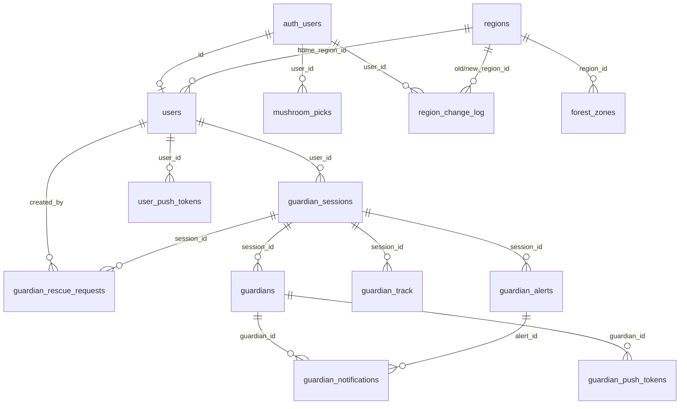

# DB Schema — Грибний Радар

Схема бази даних Supabase (PostgreSQL + PostGIS). Всі таблиці — у схемі `public`,
геометрія — `extensions.GEOMETRY(MultiPolygon, 4326)` / `GEOGRAPHY`.

Джерело істини — міграції `supabase/migrations/` (24 файли). API-контракти —
[API.md](./API.md).

---

## Огляд таблиць (19)

| Категорія | Таблиці |
|---|---|
| Користувачі | `users`, `region_change_log` |
| Довідники | `regions`, `mushroom_catalog`, `expert_rules`, `feature_flags` |
| Геодані | `forest_zones`, `forest_polygons` |
| Туки-туки | `mushroom_picks`, `calibration_log` |
| Наглядач | `guardian_sessions`, `guardians`, `guardian_track`, `guardian_alerts`, `guardian_notifications`, `guardian_rescue_requests`, `guardian_push_tokens`, `user_push_tokens`, `guardian_tick_log` |

---

## Користувачі

### `users`

Рядок створюється тригером `handle_new_user()` на `auth.users` (migration
`20260910000001`).

| Колонка | Тип | Опис |
|---|---|---|
| `id` | UUID PK → `auth.users(id)` `ON DELETE CASCADE` | = auth user id |
| `name` | TEXT | відображуване ім'я |
| `email` | TEXT | копія з Auth |
| `avatar_url` | TEXT | |
| `rating` | INT NOT NULL DEFAULT 0 | репутація |
| `total_verified_picks` | INT NOT NULL DEFAULT 0 | верифіковані знахідки |
| `home_region_id` | INT → `regions(id)` `ON DELETE SET NULL` | домашня область |
| `created_at` / `updated_at` | TIMESTAMPTZ | |

**RLS:** `users_self_read` (SELECT `auth.uid() = id`), `users_self_update`
(UPDATE `USING (auth.uid() = id)` + `WITH CHECK (auth.uid() = id)`,
hardening 20260912000017).

### `region_change_log`

Аудит зміни домашньої області (підготовка anti-abuse V2).

| Колонка | Тип |
|---|---|
| `id` | UUID PK |
| `user_id` | UUID → `auth.users(id)` CASCADE |
| `old_region_id` / `new_region_id` | INT → `regions(id)` |
| `device_fingerprint` | TEXT |
| `changed_at` | TIMESTAMPTZ |

---

## Довідники

### `regions`

27 областей України (seed `20260912000014`).

| Колонка | Тип | Опис |
|---|---|---|
| `id` | SERIAL PK | **не хардкодити в клієнті** — використовуй `slug` |
| `name` | TEXT NOT NULL | «Київська» |
| `slug` | TEXT | `kyivska` — стабільний ідентифікатор для API |
| `koatuu` / `katottg` | TEXT UNIQUE | коди КОАТУУ / КАТОТТГ |
| `polygon` | `extensions.GEOMETRY(MultiPolygon, 4326)` NOT NULL | кордон області |
| `created_at` / `updated_at` | TIMESTAMPTZ | |

**RLS:** `regions_read` — тільки `authenticated` (SELECT); публічний доступ
через `GET /regions` (service_role у Edge Function обходить RLS).

### `mushroom_catalog`

326 видів (seed з `mushroom_catalog.json`, migration `20260912000004`).

| Колонка | Тип | Опис |
|---|---|---|
| `id` | TEXT PK | канонічний snake_case id (`boletus_edulis`) |
| `name_ua` / `name_lat` | TEXT NOT NULL | назви |
| `edibility` | TEXT CHECK (`edible`/`conditionally_edible`/`inedible`/`poisonous`/`deadly_poisonous`) | їстівність |
| `edibility_label` | TEXT | «Їстівний» |
| `red_listed` | BOOLEAN NOT NULL DEFAULT FALSE | Червона книга |
| `rarity` | TEXT | рідкісність |
| `has_photo` / `popular` / `ai_recognition` | BOOLEAN NOT NULL DEFAULT FALSE | |
| `top20` | BOOLEAN NOT NULL DEFAULT FALSE | ТОП-20 (сид виставляє TRUE) |
| `features` | TEXT | |
| `months` | INT[] NOT NULL DEFAULT '{}' | місяці плодоношення |
| `attrs` | JSONB NOT NULL DEFAULT '{}' | `{tree: [], season: [], color: [], stem: []}` |
| `photos` | JSONB NOT NULL DEFAULT '[]' | `[{url}]` |
| `peak_months` | INT[] NOT NULL DEFAULT '{}' | пікові місяці |
| `zones` | TEXT[] NOT NULL DEFAULT '{}' | області поширення (slug'и) |
| `license` / `red_book_source` | JSONB | |
| `updated_at` | TIMESTAMPTZ | |

**RLS:** `catalog_read` — тільки `authenticated`.

### `expert_rules`

Правила скорингу ForecastEngine (seed 20 видів ТОП-20, migration
`20260912000002`; констрейнти — `20260912000009`). Повний набір колонок
(46) відповідає `SpeciesRule` у `supabase/functions/_shared/forecast/types.ts`.
Ключові групи:

- температури: `fruiting_temp_min/max`, `fruiting_temp_peak_min/max`, `mycelium_temp_min/max` (NUMERIC)
- вологість/опади: `humidity_min`, `rain_1d_min`, `rain_2d_min`, `rain_3d_min`, `drought_days_min`, `days_after_rain_min/max`, `waterlogged_penalty`, `drought_then_rain`
- середовище: `forest_type[]`, `habitat_type[]`, `relief_type[]`, `altitude_min/max`, `soil_ph_min/max`, `light_preference`, `stand_age_min/max`
- сезон: `season_start`, `season_end` (формат `MM-DD`), `wave_spring/summer1/summer2/autumn/late`, `peak_waves[]`, `peak_months[]`
- рефугіуми: `microrefugium_dry`, `microrefugium_wet`, `indicator_species[]`, `shock_required`
- мета: `legacy_id` UNIQUE, `mushroom_type` UNIQUE, `region_ids[]`, `weight`, `mvp_stage` (`mvp` за замовчуванням), `last_calibrated_at`

**RLS:** `expert_rules_read` — тільки `authenticated`; запис — лише service_role.
Повний актуальний набір правил для regression-тестів —
`supabase/tests/fixtures/rules-subset.json`.

### `feature_flags`

Флаги ForecastEngine (`loadFeatureFlags`).

| Колонка | Тип |
|---|---|
| `key` | TEXT PK |
| `enabled` | BOOLEAN NOT NULL DEFAULT TRUE |
| `value` | JSONB NOT NULL DEFAULT 'null' |
| `updated_at` | TIMESTAMPTZ |

Рівні: `fruiting_temp_buffer`, `region_filter_enabled`,
`auto_calibration_enabled`, `rule5_anti_double_counting_enabled`,
`indicator_pidvyshen_enabled`, `pressure_enabled`, `light_enabled`,
`relief_enabled`, `gdd_enabled`, `peak_wave_bonus_enabled`.

---

## Геодані

### `forest_zones`

Полігони лісових зон (окремий шар; `find_zone_by_point`).

| Колонка | Тип | Опис |
|---|---|---|
| `id` | UUID PK | |
| `polygon` | `extensions.GEOMETRY(MultiPolygon, 4326)` NOT NULL | межа зони |
| `forest_type` | TEXT | |
| `stand_age_years` | INT CHECK 0..500 | вік деревостану |
| `stand_age_source` | TEXT CHECK (`inventory`/`ndvi`/`user`) | |
| `stand_age_confidence` | NUMERIC(3,2) CHECK 0..1 | |
| `relief_type` | TEXT | |
| `light_type` | TEXT | |
| `region_id` | INT → `regions(id)` | область |
| `created_at` | TIMESTAMPTZ | |

**RLS:** `forest_zones_read` — тільки `authenticated`. Клієнтський доступ —
через RPC `find_zone_by_point` (stand_age/relief/light для прогнозу).

### `forest_polygons`

OSM-геозони лісів (migration `20260911000003`).

| Колонка | Тип |
|---|---|
| `id` | BIGSERIAL PK |
| `polygon` | `GEOGRAPHY(MultiPolygon, 4326)` NOT NULL |
| `source` | TEXT NOT NULL DEFAULT 'osm' |
| `osm_id` | BIGINT |
| `region_id` | INT (без FK — для гнучкості імпорту) |
| `created_at` | TIMESTAMPTZ |

**RLS + доступ:** RLS увімкнено, політик немає (deny-all) **і** жодних GRANT
для `anon`/`authenticated` — таблиця лише для service_role
(hardening 20260912000017). Перевірка точки — RPC `is_point_in_forest`
(SECURITY INVOKER, викликається з Edge Function із service_role).

---

## Тук-туки

### `mushroom_picks`

| Колонка | Тип | Опис |
|---|---|---|
| `id` | UUID PK | |
| `user_id` | UUID NOT NULL → `auth.users(id)` CASCADE | автор |
| `trip_id` | UUID NULL | походи (зарезервовано) |
| `geom` | `GEOGRAPHY(Point, 4326)` NOT NULL | координати знахідки |
| `photo_url` | TEXT NULL | шлях у bucket `mushroom-photos` (не публічний URL) |
| `mushroom_type` | TEXT NOT NULL | id каталогу |
| `forest_type` | TEXT NULL | |
| `weather_data` | JSONB NULL | умови (наприклад `{gpsAccuracy}`) |
| `pick_type` | TEXT NOT NULL CHECK (`private`/`friends`/`public`) | видимість |
| `shared_with` | UUID[] NOT NULL DEFAULT '{}' | |
| `verification_status` | TEXT NOT NULL DEFAULT 'pending' | `pending`/`verified`/`rejected` |
| `verified_by` | UUID NULL → `auth.users(id)` | |
| `weight` | NUMERIC(3,2) NOT NULL DEFAULT 1.0 | вага для краудсорсингу |
| `is_indicator` | BOOLEAN NOT NULL DEFAULT FALSE | індикаторний вид |
| `is_negative` | BOOLEAN NOT NULL DEFAULT FALSE | негативний звіт |
| `created_at` | TIMESTAMPTZ | |

**RLS:** `mushroom_picks_read` — owner | `shared_with` | `public` |
same `home_region`; `mushroom_picks_insert` — тільки свої рядки.

### `calibration_log`

Аудит автокалібровки правил: `date`, `species`, `param`, `old_value`,
`new_value`, `reason`, `approved_by` → `auth.users(id)`, `created_at`.

---

## Наглядача (Guardian)

Контур сесій грибника з Наглядачем. Auth — не JWT, а токен Наглядача
(`X-Guardian-Token`).

### `guardian_sessions`

20 колонок: `id` UUID PK, `user_id` → `users(id)` CASCADE, `status`
(`pending`/`active`/`closing`/`closed`/`recoverable`), `previous_status`
(той самий enum; додано `20260911000002`, для cancel-close), `expected_return`,
`original_return`, `started_at`, `closing_started_at`, `closed_at`,
`recoverable_until`, `last_known_coords` GEOGRAPHY, `last_known_at`,
`last_battery_pct` (0..100), `last_signal_strength` (0..5),
`exit_detected_at`, `sos_activated_at`, `overdue_level`
(`soft`/`medium`/`hard`), `settings` JSONB, `created_at`, `updated_at`.

**RLS:** `guardian_sessions_self_*` (read/insert/update) — `user_id = auth.uid()`.

### `guardians`

`id` UUID PK, `session_id` → `guardian_sessions(id)` CASCADE, `name`,
`phone`, `token_hash` UNIQUE, `token_prefix`, `is_emergency`,
`notified_at`, `last_seen_at`, `revoked_at`, `created_at`.
**RLS:** `guardians_owner_*` — через існування сесії користувача.

### `guardian_track`

`id` BIGSERIAL PK, `session_id` → `guardian_sessions(id)` CASCADE,
`coords` GEOGRAPHY NOT NULL, `recorded_at`, `battery_pct`, `signal_strength`,
`speed_kmh`, `was_offline`, `created_at`.
**RLS:** `guardian_track_owner_*`.

### `guardian_alerts`

`id` BIGSERIAL PK, `session_id` → `guardian_sessions(id)` CASCADE,
`alert_type` (`sos`/`overdue_soft`/`overdue_medium`/`overdue_hard`/`offline`),
`payload` JSONB, `delivered_at`, `created_at`. На INSERT — тригер
`notify_guardian_alert()` → HTTP POST на Edge Function `guardian-notify`.

### `guardian_notifications`

`id` BIGSERIAL PK, `guardian_id` → `guardians(id)` CASCADE,
`alert_id` → `guardian_alerts(id)` SET NULL, `channel`
(`push`/`sms`), `status`, `provider_message_id`, `error_message`,
`sent_at`, `delivered_at`, `created_at`.

### `guardian_rescue_requests`

`id` UUID PK, `session_id` → `guardian_sessions(id)` CASCADE,
`created_by` → `users(id)`, `token_hash` UNIQUE, `token_prefix`,
`target` (def `101`), `notes`, `payload` JSONB, `expires_at`,
`resolved_at`, `resolved_note`, `viewed_count`, `last_viewed_at`,
`created_at`. Політики `guardian_rescue_owner_*` (created_by +
перевірка сесії; `WITH CHECK` додано 20260912000017).

### `guardian_push_tokens`

`id` BIGSERIAL PK, `guardian_id` → `guardians(id)` CASCADE, `fcm_token`,
`user_agent`, `created_at`, `last_seen_at`, `revoked_at`.

### `user_push_tokens`

`id` BIGSERIAL PK, `user_id` → `users(id)` CASCADE, `fcm_token`,
`platform` (`android`/`ios`/`web`), `device_info` JSONB, `created_at`,
`last_seen_at`, `revoked_at`.

### `guardian_tick_log`

`id` BIGSERIAL PK, `started_at`, `finished_at`, `sessions_scanned`,
`transitions_made`, `alerts_created`, `errors`, `error_details` JSONB.

> `guardian_push_tokens`, `user_push_tokens`, `guardian_tick_log` —
> service_role only: RLS без політик (deny-all) + REVOKE від anon/authenticated
> + FORCE ROW LEVEL SECURITY (hardening 20260912000017). Запис — лише через
> Edge Functions з service_role key.

---

## ER-діаграма (тільки реальні FK)

> Зовнішні ключі взяті з DDL міграцій. Таблиці без FK (`mushroom_catalog`,
> `expert_rules`, `feature_flags`, `forest_polygons`, `guardian_tick_log`,
> `calibration_log`) на діаграмі не відображені зв'язками — `calibration_log.approved_by`
> та `mushroom_picks.verified_by` теж References на `auth.users(id)`.

---

## RPC-функції

| Функція | Призначення | Хто викликає |
|---|---|---|
| `find_zone_by_point(lat, lng)` | forest_zone за точкою (stand_age, relief, light) | ForecastEngine (`ContextBuilder`) |
| `point_in_region(lat, lng, region_id)` | точка в межах області (RegionGuard) | ForecastEngine |
| `find_region_by_slug(slug_input)` | slug → `{id, name}` | `PATCH /me`, `GET /picks?scope=region` |
| `is_point_in_forest(lat, lng)` | точка в лісі (forest_polygons) | geofence (service_role) |
| `months_to_waves(...)` | календар хвиль | довідково |
| `guardian_fn_config()` | url + service_key з Vault для cron/тригерів | cron jobs, `notify_guardian_alert` (SECURITY DEFINER) |
| `notify_guardian_alert()` | тригер на `guardian_alerts` → HTTP на `guardian-notify` | AFTER INSERT тригер |
| `handle_new_user()` | тригер на `auth.users` → створення рядка `users` | AFTER INSERT тригер |
| `update_updated_at_column()` | `updated_at` тригери | BEFORE UPDATE тригери |
| `check_expert_rules_safe()` | валідація констрейнтів правил | міграція 20260912000009 |

GRANT EXECUTE на `find_zone_by_point`, `point_in_region`,
`find_region_by_slug` — `authenticated` (Edge Functions викликають через
service_role клієнт, який обходить RLS).

---

## Безпека (hardening, аудит B)

- 15/19 таблиць мають RLS-політики; 4 службові таблиці (`guardian_push_tokens`,
  `user_push_tokens`, `forest_polygons`, `guardian_tick_log`) — RLS без політик
  (deny-all) + `REVOKE ALL` від `anon`/`authenticated` + `FORCE ROW LEVEL SECURITY`.
- `service_role` має `BYPASSRLS` → Edge Functions працюють незалежно від FORCE RLS.
- 3 UPDATE-політики з явним `WITH CHECK`: `users_self_update`,
  `guardians_owner_update`, `guardian_rescue_owner_update`.
- `guardian_fn_config()` — `SECURITY DEFINER`, `search_path = public, vault`,
  EXECUTE лише для `postgres`/`service_role`.
- `notify_guardian_alert()` — `SECURITY DEFINER`, `SET search_path = public, vault`.

Деталі — міграція `20260912000017_security_hardening.sql`.
